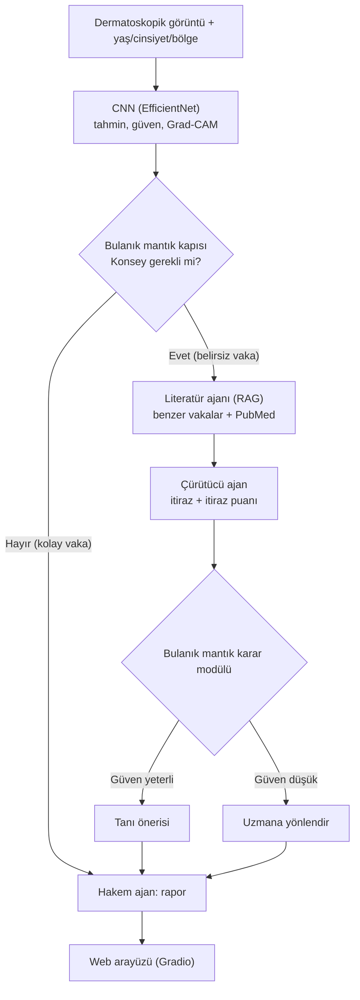
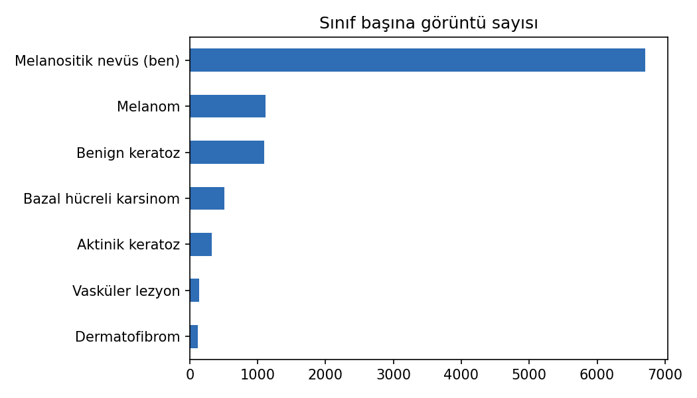

# Dermatoloji Konseyi: Çok Ajanlı Medikal Konsültasyon Sistemi

Cilt lezyonu görüntülerini sınıflandıran bir derin öğrenme modelinin kararını, birbirini denetleyen yapay zekâ ajanlarıyla sorgulayan bir **karar destek sistemi**.

> ⚠️ **Uyarı:** Bu proje eğitim ve araştırma amaçlıdır. Tıbbi teşhis aracı değildir ve klinik kararların yerine geçmez.

**Bitirme Projesi** · Fırat Üniversitesi, Yazılım Mühendisliği

**Hazırlayan:** Sabri Baz 

---

## Proje Özeti

Tıbbi görüntü sınıflandırıcıları yanlış olduklarında da yüksek güvenle karar verebilir ve kararlarının gerekçesini açıklamaz. Bu proje, bir hastanedeki doktor konseyini taklit eder:

1. **CNN** dermatoskopik görüntüyü sınıflandırır.
2. **Bulanık mantık kapısı**, modelin güvenine ve hasta riskine bakarak vakanın konseye gidip gitmeyeceğine karar verir.
3. **Literatür ajanı (RAG)** benzer vakaları ve PubMed literatürünü getirir.
4. **Çürütücü ajan** bu kanıtla CNN'in teşhisini çürütmeye çalışır ve itirazını puanlar.
5. **Bulanık mantık karar modülü** tüm sonuçları tartarak "tanı önerisi" ya da "uzmana yönlendir" kararı verir.
6. **Hakem ajan** kararı kaynaklı bir rapora döker.

Projenin katkısı, bu denetimin **kaç yanlış teşhisi düzelttiğini ve kaç doğru teşhisi bozduğunu** sayısal olarak ölçmektir.

## Sistem Mimarisi



## Veri Seti

| Veri | İçerik | Kullanım |
|---|---|---|
| [HAM10000](https://doi.org/10.7910/DVN/DBW86T) | 10.015 dermatoskopik görüntü, 7 sınıf, 7.470 lezyon | CNN eğitimi/testi, benzer vaka arşivi |
| PubMed özetleri | 7 sınıfla ilgili makale özetleri | Literatür ajanının bilgi tabanı |

Veri seti lisansı (ticari olmayan kullanım) ve boyutu nedeniyle **bu repoda yer almaz**. İndirmek için `notebooks/01_veri_hazirligi.ipynb` defterini çalıştırın (Kaggle hesabı gerekir).

**Ayrım:** Eğitim / doğrulama / test ayrımı **lezyon bazlı** ve tabakalıdır (%70 / %15 / %15). Aynı lezyonun görüntüleri hiçbir zaman iki kümeye birden düşmez.

| Sınıf | Eğitim | Doğrulama | Test |
|---|---|---|---|
| Melanositik nevüs (ben) | 4730 | 975 | 1000 |
| Melanom | 777 | 168 | 168 |
| Benign keratoz | 775 | 167 | 157 |
| Bazal hücreli karsinom | 365 | 72 | 77 |
| Aktinik keratoz | 233 | 43 | 51 |
| Vasküler lezyon | 98 | 22 | 22 |
| Dermatofibrom | 76 | 17 | 22 |
| **Toplam** | **7054** | **1464** | **1497** |

### Veri Kalite Kontrolleri

| Kontrol | Sonuç |
|---|---|
| Görüntü çözünürlüğü | 10.015 görüntünün tamamı 600×450 |
| Birebir aynı dosya (MD5) | 2 çift; her çift aynı lezyon ve tanıya ait, aynı kümede. Kümeler arası sızıntı yok |
| Bilinmeyen yaş | 57 görüntü |
| Bilinmeyen cinsiyet | 57 görüntü (47'sinde yaş da bilinmiyor) |
| Bilinmeyen lezyon bölgesi | 234 görüntü |



Ayrım dosyası: [`results/ham10000_split_ids.csv`](results/ham10000_split_ids.csv) · Ayrım tablosu: [`results/01_ayrim_tablosu.csv`](results/01_ayrim_tablosu.csv)

## Kullanılan Teknolojiler

| Katman | Teknoloji |
|---|---|
| Geliştirme ortamı | Google Colab Pro, Google Drive |
| Görüntü sınıflandırma | TensorFlow / Keras, EfficientNet, sıcaklık ölçekleme, Grad-CAM |
| RAG | MedCPT, FAISS, Biopython (PubMed) |
| Ajanlar | Dil modeli API'si |
| Karar modülü | scikit-fuzzy (bulanık mantık) |
| Arayüz | Gradio, Hugging Face Spaces |

## Repo Yapısı

```
notebooks/   Colab defterleri (her adım için bir defter)
src/         Tekrar kullanılan Python kodları
results/     Küçük sonuç tabloları ve grafikler
docs/        Proje önerisi, tez notları (tez_notlari.md), taslaklar
```

## İlerleme

- [x] **Adım 1:** Veri indirme, inceleme ve lezyon bazlı ayrım
- [ ] **Adım 2:** CNN eğitimi (EfficientNet)
- [ ] **Adım 3:** Kalibrasyon, Grad-CAM, değerlendirme (Deney 1)
- [ ] **Adım 4:** Benzer vaka arşivi (CNN gömmeleri + FAISS)
- [ ] **Adım 5:** PubMed literatür kütüphanesi (MedCPT + FAISS)
- [ ] **Adım 6:** Literatür ajanı (Deney 2)
- [ ] **Adım 7:** Çürütücü ajan
- [ ] **Adım 8:** Bulanık mantık kapısı ve karar modülü (Deney 3-4)
- [ ] **Adım 9:** Hakem ajan ve rapor
- [ ] **Adım 10:** Toplu değerlendirme ve hata analizi
- [ ] **Adım 11:** Web arayüzü
- [ ] **Adım 12:** Tez yazımı

## Haftalık Günlük

| Hafta | Yapılanlar | Sonuç / Not |
|---|---|---|
| 1 | Veri indirildi, incelendi, lezyon bazlı ayrım yapıldı; ek kalite kontrolleri (çözünürlük, MD5 kopya, bilinmeyen meta veri) | 10.015 görüntü, 7.470 lezyon; görüntülerin ~%45'i birden fazla fotoğrafı olan lezyonlara ait, bu yüzden lezyon bazlı ayrım zorunlu. Kümeler arası sızıntı yok |

## Kaynaklar

- Tschandl, P., Rosendahl, C., Kittler, H. (2018). *The HAM10000 dataset, a large collection of multi-source dermatoscopic images of common pigmented skin lesions.* Scientific Data, 5, 180161.
- Jin, Q. ve diğ. (2023). *MedCPT: Contrastive Pre-trained Transformers with large-scale PubMed search logs for zero-shot biomedical information retrieval.* Bioinformatics.
