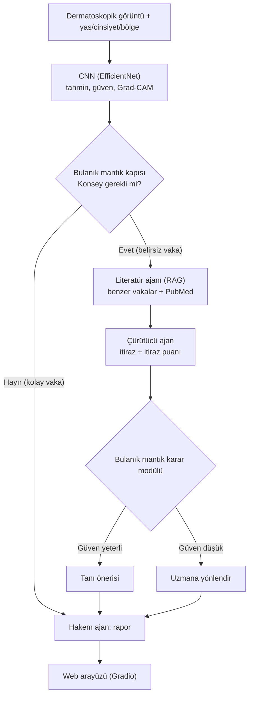
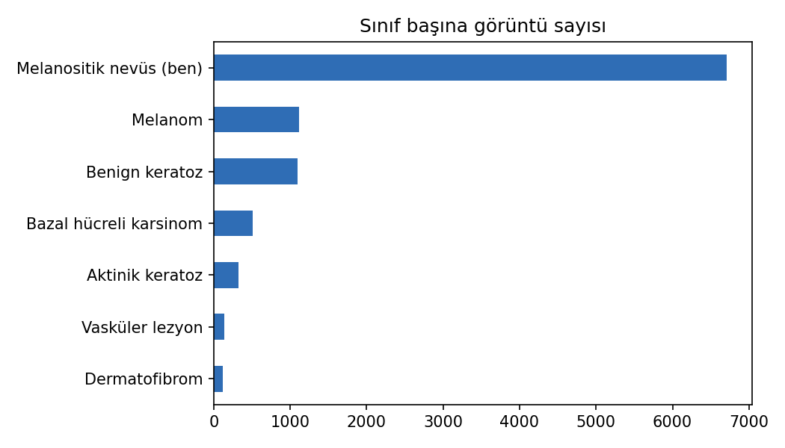

# Dermatoloji Konseyi: Çok Ajanlı Medikal Konsültasyon Sistemi

Cilt lezyonu görüntülerini sınıflandıran bir derin öğrenme modelinin kararını, birbirini denetleyen yapay zekâ ajanlarıyla sorgulayan bir **karar destek sistemi**.

> ⚠️ **Uyarı:** Bu proje eğitim ve araştırma amaçlıdır. Tıbbi teşhis aracı değildir ve klinik kararların yerine geçmez.

**Bitirme Projesi** · Fırat Üniversitesi, Yazılım Mühendisliği

**Hazırlayan:** Sabri Baz 

---

## Proje Özeti

Tıbbi görüntü sınıflandırıcıları yanlış olduklarında da yüksek güvenle karar verebilir ve kararlarının gerekçesini açıklamaz. Bu proje, bir hastanedeki doktor konseyini taklit eder:

1. **CNN** dermatoskopik görüntüyü sınıflandırır.
2. **Bulanık mantık kapısı**, modelin güvenine ve hasta riskine bakarak vakanın konseye gidip gitmeyeceğine karar verir.
3. **Literatür ajanı (RAG)** benzer vakaları ve PubMed literatürünü getirir.
4. **Çürütücü ajan** bu kanıtla CNN'in teşhisini çürütmeye çalışır ve itirazını puanlar.
5. **Bulanık mantık karar modülü** tüm sonuçları tartarak "tanı önerisi" ya da "uzmana yönlendir" kararı verir.
6. **Hakem ajan** kararı kaynaklı bir rapora döker.

Projenin katkısı, bu denetimin **kaç yanlış teşhisi düzelttiğini ve kaç doğru teşhisi bozduğunu** sayısal olarak ölçmektir.

## Sistem Mimarisi



## Veri Seti

| Veri | İçerik | Kullanım |
|---|---|---|
| [HAM10000](https://doi.org/10.7910/DVN/DBW86T) | 10.015 dermatoskopik görüntü, 7 sınıf, 7.470 lezyon | CNN eğitimi/testi, benzer vaka arşivi |
| PubMed özetleri | 4.129 makale özeti (2000-2025, İngilizce, dermoskopi odaklı; yapay zekâ makaleleri hariç) | Literatür ajanının bilgi tabanı |

Veri seti lisansı (ticari olmayan kullanım) ve boyutu nedeniyle **bu repoda yer almaz**. İndirmek için `notebooks/01_veri_hazirligi.ipynb` defterini çalıştırın (Kaggle hesabı gerekir).

**Ayrım:** Eğitim / doğrulama / test ayrımı **lezyon bazlı** ve tabakalıdır (%70 / %15 / %15). Aynı lezyonun görüntüleri hiçbir zaman iki kümeye birden düşmez.

| Sınıf | Eğitim | Doğrulama | Test |
|---|---|---|---|
| Melanositik nevüs (ben) | 4730 | 975 | 1000 |
| Melanom | 777 | 168 | 168 |
| Benign keratoz | 775 | 167 | 157 |
| Bazal hücreli karsinom | 365 | 72 | 77 |
| Aktinik keratoz | 233 | 43 | 51 |
| Vasküler lezyon | 98 | 22 | 22 |
| Dermatofibrom | 76 | 17 | 22 |
| **Toplam** | **7054** | **1464** | **1497** |

### Veri Kalite Kontrolleri

| Kontrol | Sonuç |
|---|---|
| Görüntü çözünürlüğü | 10.015 görüntünün tamamı 600×450 |
| Birebir aynı dosya (MD5) | 2 çift; her çift aynı lezyon ve tanıya ait, aynı kümede. Kümeler arası sızıntı yok |
| Bilinmeyen yaş | 57 görüntü |
| Bilinmeyen cinsiyet | 57 görüntü (47'sinde yaş da bilinmiyor) |
| Bilinmeyen lezyon bölgesi | 234 görüntü |



Ayrım dosyası: [`results/ham10000_split_ids.csv`](results/ham10000_split_ids.csv) · Ayrım tablosu: [`results/01_ayrim_tablosu.csv`](results/01_ayrim_tablosu.csv)

## Sonuçlar: Adım 2-3 (CNN)

Seçim yalnızca doğrulama kümesinde yapıldı; son CNN'in ayarları dondurulduktan sonra test kümesi açıldı. *Şeffaflık notu:* önceki sürümde (`03_..._v1`) B0 v3'ün test sonucu görülmüştü; seçim ve ayarlar yine yalnızca doğrulamaya dayanır. Son CNN: **Topluluk + TTA** (EfficientNet-B0 v3 ve B3 v3 ortalaması, test zamanı artırma ile; sıcaklık T = 1,178).

| Test kümesi (1.497 görüntü) | Ayarsız karar | Klinik eşikli karar (τ = 0,8) |
|---|---|---|
| Doğruluk | 0,821 | 0,741 |
| Dengeli doğruluk | 0,653 | 0,705 |
| Melanom duyarlılığı | 0,756 | 0,869 |
| Nevüs duyarlılığı | 0,887 | 0,734 |

Güven kalibrasyonu iyidir (ECE ≈ 0,02). Güven düşük vakaların %20'si uzmana yönlendirildiğinde doğruluk 0,903'e, kaçırılan melanom sayısı 41'den 16'ya iner.

| | |
|---|---|
|  |  |
|  |  |

Ayrıntılar ve sınırlılıklar: [`docs/tez_notlari.md`](docs/tez_notlari.md)

**Dondurulmuş son CNN ayarları:** [`results/03v2_son_cnn.json`](results/03v2_son_cnn.json) (üyeler, sıcaklık, eşikler, sınıf öncülleri). Adım 2'nin tek model seçimi: [`results/02_secilen_model.json`](results/02_secilen_model.json). Sürüm karşılaştırmaları için `results/02_cnn_b0_v{2,3,4}_*.png` (eğitim eğrileri ve karışıklık matrisleri).

**Tezde kanıt olarak kullanılacak sonuç dosyaları:**
- [`results/03v2_secim_ve_donmus_ayarlar.json`](results/03v2_secim_ve_donmus_ayarlar.json): bütün adayların doğrulama tablosu ve dondurulmuş ayarları
- [`results/03v2_test_sonuclari.json`](results/03v2_test_sonuclari.json): bütün adayların test sonuçları
- `results/02_*_dogrulama_metrikleri.json`: v1-v4 ve B3 v3 doğrulama metrikleri
- `results/02_cnn_b3_v3_egitim_egrisi.png`, `results/02_cnn_b3_v3_karisiklik_matrisi.png`: B3 v3 grafikleri

### Modeller ve büyük dosyalar

Eğitilmiş modeller (`.keras`, 80-215 MB) ve logit dosyaları (`.npy`) boyut nedeniyle repoda yoktur; Google Drive'daki `models/` klasöründe tutulur:

| Dosya | Açıklama |
|---|---|
| `cnn_b0_v3.keras`, `cnn_b3_v3.keras` | Son topluluğun üyeleri |
| `cnn_b0_v2.keras`, `cnn_b0_v4.keras` | Karşılaştırma modelleri |
| `son_cnn_dogrulama_logit.npy`, `son_cnn_test_logit.npy` | Son CNN'in ham çıktıları (Adım 5'te bulanık mantık kapısı için kullanıldı) |
| `rag/` (`arsiv.faiss`, `arsiv_meta.csv`, `gomme_*.npy`, `komsular_*.npz`, `arsiv_olasilik_*.npy`, `04_arsiv_ayarlari.json`) | Adım 4: benzer vaka arşivi, gömmeler ve arşiv olasılıkları |
| `bulanik/` (`05_kapi_ayarlari.json`, `kapi_skoru_*.npy`) | Adım 5: dondurulmuş kapı ayarları ve vaka puanları |
| `rag/` (`pubmed.faiss`, `pubmed_makaleler.parquet`, `pubmed_gomme.npy`, `06_pubmed_ayarlari.json`) | Adım 6: PubMed makale indeksi, makale tablosu ve vektörleri |

## Sonuçlar: Adım 4 (Benzer Vaka Arşivi)

Dondurulmuş son CNN'in `gap` katmanı her görüntü için gömme vektörü üretir (B0 1.280 + B3 1.536 = 2.816 boyut, 8 yönlü TTA ortalaması). **Arşiv yalnızca eğitim kümesidir** (7.054 görüntü); doğrulama ve test görüntüleri arşivde aranır, arşive eklenmez. Arama FAISS `IndexFlatIP` (kosinüs benzerliği) ile yapılır. Gömmelerden hesaplanan logitler Adım 3 logitleriyle birebir tutarlıdır (fark 0,0000). Aramada sızıntı yoktur ve 0,98 üstü benzerlikte "neredeyse kopya" sorgu yoktur.

k ve oylama türü yalnızca doğrulamada seçildi: **k = 50, dengeli oy** (dengeli doğruluk 0,782).

| Test kümesi | Arşiv tek başına (k-en yakın komşu) | CNN ayarsız | CNN klinik eşikli |
|---|---|---|---|
| Doğruluk | 0,754 | 0,821 | 0,741 |
| Dengeli doğruluk | 0,775 | 0,653 | 0,705 |
| Melanom duyarlılığı | 0,821 | 0,756 | 0,869 |
| Nevüs duyarlılığı | 0,748 | 0,887 | 0,734 |

CNN ile arşiv testte vakaların %86,4'ünde aynı tanıyı söyler. Uyumlu vakalarda CNN doğruluğu 0,802, uyumsuz vakalarda 0,358'dir; yani uyumsuzluk "konsey toplansın" sinyali taşır. CNN'in yanlış, arşivin doğru olduğu **kurtarılabilir hata** sayısı testte 91'dir.

Sonuçlar: [`results/04_arsiv_sonuclari.json`](results/04_arsiv_sonuclari.json) · [t-SNE](results/04_gomme_tsne.png) · benzer vaka örnekleri: [1](results/04_benzer_vaka_ornek_1.png), [2](results/04_benzer_vaka_ornek_2.png), [3](results/04_benzer_vaka_ornek_3.png), [4](results/04_benzer_vaka_ornek_4.png)

## Sonuçlar: Adım 5 (Bulanık Mantık Kapısı)

Her vaka için 0-100 arası bir **konsey gerekliliği puanı** üretilir. Girdiler: güven (kalibre CNN), uyum (arşivin CNN kararına verdiği olasılık), risk (kötü huylu sınıfların olasılığı) ve yaş. Mamdani çıkarımı ve 12 Türkçe kural kullanılır; üyelik kümeleri doğrulama dağılımının %5/%50/%95 yüzdeliklerinden kurulur, etiket bilgisi kullanılmaz. Kendi çıkarım kodu `scikit-fuzzy` ile doğrulandı (en büyük fark 0,25 puan). Eşik, doğrulama puanlarının %80. yüzdeliğidir (83,11).

Test kümesinde aynı sayıda (353 vaka, %23,6) vakayı uzmana gönderen yöntemlerin karşılaştırması:

| Yöntem | Doğruluk | Dengeli doğruluk | Kaçırılan melanom | Yanlış alarm (nevüs) |
|---|---|---|---|---|
| Hiç konsey yok | - | 0,705 | 22 | 169 |
| Yalnız güven | 0,890 | 0,778 | 16 | 28 |
| Güven + uyumsuzluk | 0,873 | 0,868 | 11 | 57 |
| **Bulanık kapı** | 0,859 | 0,848 | 12 | 63 |
| Bulanık, arşivsiz | 0,886 | 0,766 | 17 | 28 |
| Bulanık, yaş kuralsız | 0,864 | 0,857 | 12 | 60 |

Eşleştirilmiş, lezyon bazlı bootstrap (1.000 tekrar): bulanık kapı "yalnız güven"e göre dengeli doğrulukta belirgin biçimde iyidir (+0,070; %95 GA +0,021 / +0,124), ancak "güven + uyumsuzluk" kuralına göre fark belirgin değildir (-0,019; GA -0,061 / +0,019). Arşiv bilgisi çıkarıldığında (arşivsiz) dengeli doğruluk 0,848'den 0,766'ya düşer; yani arşivin katkısı belirgindir. Her karar için hangi kuralların ateşlendiği gösterilebilir (açıklanabilirlik).

Sonuçlar: [`results/05_bulanik_kapi_sonuclari.json`](results/05_bulanik_kapi_sonuclari.json) · [üyelik fonksiyonları](results/05_uyelik_fonksiyonlari.png) · [kontrol yüzeyi](results/05_kontrol_yuzeyi.png) · [karşılaştırma eğrileri](results/05_karsilastirma_egrileri.png) · Kod: [`src/bulanik_kapi.py`](src/bulanik_kapi.py)

> **Not:** Bu aşamada konseye giden vakalar henüz değerlendirilmemiştir; o iş ajanların olacak. Ölçütler sistemin kendi karar verdiği vakalarda hesaplanır.

## Sonuçlar: Adım 6 (PubMed Literatür Kütüphanesi)

NCBI E-utilities (Biopython) ile 9 toplama sorgusundan (7 tanı sınıfı, melanomun nevüsten ayrımı, melanom risk faktörleri) 4.140 tekil makale bulundu, 4.133'ü indirildi. Geri çekilmiş (1) ve özeti çok kısa (3) makaleler çıkarılınca **4.129 makale** kaldı. Makale başlığı ve özeti **MedCPT Article Encoder** ile 768 boyutlu vektöre çevrilir (makalelerin %5,1'i 512 parçaya kesilir) ve FAISS `IndexFlatIP` indeksine konur. Arama iki aşamalıdır: MedCPT sorgu kodlayıcısıyla 50 aday bulunur, **MedCPT çapraz kodlayıcı** adayları yeniden sıralar.

Değerlendirme: her sınıf için sonuçlara bakılmadan önce yazılmış 3 klinik soru (toplam 21). Ölçüt **sınıf isabeti@5**: ilk 5 makaleden kaçının o sınıfın toplama sorgusundan geldiği. Gerçek bir ilgililik etiketi olmadığı için bu kaba bir vekildir.

| Yöntem | Ortalama sınıf isabeti@5 |
|---|---|
| Yalnız FAISS (sorgu kodlayıcı) | 0,952 |
| FAISS + çapraz kodlayıcı ile yeniden sıralama | **0,971** |

Zayıf noktalar: benign keratoz (0,87) ve, yalnız FAISS'te, vasküler lezyon (0,80; yeniden sıralamayla 1,00). Dağılım grafiği: [`results/06_pubmed_dagilim.png`](results/06_pubmed_dagilim.png) · Sonuçlar: [`results/06_pubmed_sonuclari.json`](results/06_pubmed_sonuclari.json) · Arama kodu: [`src/pubmed_arama.py`](src/pubmed_arama.py)

## Kullanılan Teknolojiler

| Katman | Teknoloji |
|---|---|
| Geliştirme ortamı | Google Colab Pro, Google Drive |
| Görüntü sınıflandırma | TensorFlow / Keras, EfficientNet, sıcaklık ölçekleme, Grad-CAM |
| RAG | MedCPT, FAISS, Biopython (PubMed) |
| Ajanlar | Dil modeli API'si |
| Benzer vaka arama | FAISS (`IndexFlatIP`, kosinüs benzerliği) |
| Karar modülü | scikit-fuzzy (bulanık mantık) |
| Arayüz | Gradio, Hugging Face Spaces |

## Repo Yapısı

```
notebooks/   Colab defterleri (NN_konu_vX.ipynb; v3 için _b0 ve _b3 çalıştırmaları ayrı defterlerdir; ayrıntı için notebooks/README.md)
src/         Tekrar kullanılan Python kodları (`bulanik_kapi.py`: Adım 5 kapı modülü, `pubmed_arama.py`: Adım 6 arama modülü, `llm_istemci.py` ve `literatur_ajani.py`: Adım 7 LLM istemcisi ve literatür ajanı)
results/     Küçük sonuç tabloları, dondurulmuş ayar dosyaları (.json) ve grafikler
docs/        Proje önerisi, tez notları (tez_notlari.md), taslaklar
```

## İlerleme

- [x] **Adım 1:** Veri indirme, inceleme ve lezyon bazlı ayrım
- [x] **Adım 2:** CNN eğitimi (EfficientNet B0/B3, 4 sürüm)
- [x] **Adım 3:** Kalibrasyon, Grad-CAM, değerlendirme (Deney 1); son CNN: Topluluk + TTA, donduruldu
- [x] **Adım 4:** Benzer vaka arşivi (CNN gömmeleri + FAISS)
- [x] **Adım 5:** Bulanık mantık kapısı ("konsey toplansın mı?"); asgari sürüm (CNN + arşiv + kapı) tamamlandı
- [x] **Adım 6:** PubMed literatür kütüphanesi (MedCPT + FAISS)
- [ ] **Adım 7:** Literatür ajanı (Deney 2)
- [ ] **Adım 8:** Çürütücü ajan
- [ ] **Adım 9:** Bulanık mantık karar modülü (Deney 3-4)
- [ ] **Adım 10:** Hakem ajan ve rapor
- [ ] **Adım 11:** Toplu değerlendirme ve hata analizi
- [ ] **Adım 12:** Web arayüzü
- [ ] **Adım 13:** Tez yazımı

## Haftalık Günlük

| Hafta | Yapılanlar | Sonuç / Not |
|---|---|---|
| 1 | Veri indirildi, incelendi, lezyon bazlı ayrım yapıldı; ek kalite kontrolleri (çözünürlük, MD5 kopya, bilinmeyen meta veri) | 10.015 görüntü, 7.470 lezyon; görüntülerin ~%45'i birden fazla fotoğrafı olan lezyonlara ait, bu yüzden lezyon bazlı ayrım zorunlu. Kümeler arası sızıntı yok |
| 2-3 | CNN eğitimi (4 sürüm, B0 ve B3; v4 v3'ten daha kötü çıktı: 0,658 / 0,695), aday ve topluluk karşılaştırması, sıcaklık ölçekleme, test değerlendirmesi, uzmana yönlendirme analizi, Grad-CAM | Son CNN: Topluluk (B0 v3 + B3 v3) + TTA. Test: doğruluk 0,821, dengeli doğruluk 0,653, melanom duyarlılığı 0,756; klinik eşikle melanom duyarlılığı 0,869. Isı haritalarının kenar payı ortanca %14 |
| 4-5 | Benzer vaka arşivi (CNN gömmeleri + FAISS, k = 50 dengeli oy); bulanık mantık kapısı (12 kural, Mamdani, scikit-fuzzy ile doğrulandı); temel çizgilerle ve ablasyonla karşılaştırma, bootstrap | Arşiv tek başına test dengeli doğruluğu 0,775; CNN-arşiv uyumsuzluğu hata sinyali (uyumlu 0,802 / uyumsuz 0,358 doğruluk). Kapı, yalnız güvene göre dengeli doğrulukta +0,070 daha iyi (belirgin); arşivsiz hâli 0,766'ya düşer |
| 6 | PubMed literatür kütüphanesi: 9 sorgu ile makale toplama, temizleme, MedCPT vektörleri, FAISS indeksi, sorgu kodlayıcı + çapraz kodlayıcı ile iki aşamalı arama | 4.129 makale; 21 önceden yazılmış soruda sınıf isabeti@5: FAISS 0,952, yeniden sıralama 0,971 |

## Kaynaklar

- Tschandl, P., Rosendahl, C., Kittler, H. (2018). *The HAM10000 dataset, a large collection of multi-source dermatoscopic images of common pigmented skin lesions.* Scientific Data, 5, 180161.
- Jin, Q. ve diğ. (2023). *MedCPT: Contrastive Pre-trained Transformers with large-scale PubMed search logs for zero-shot biomedical information retrieval.* Bioinformatics.
