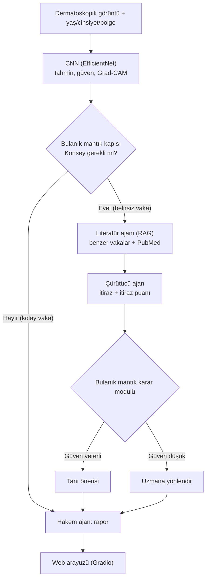
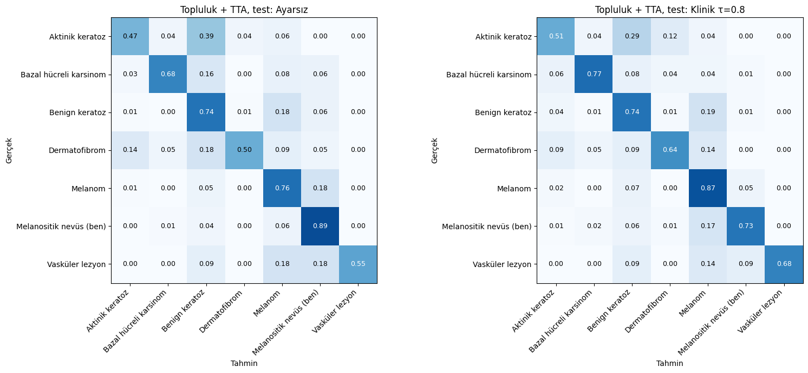
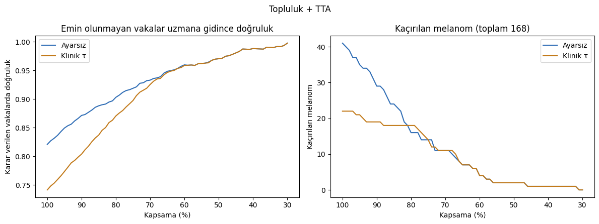
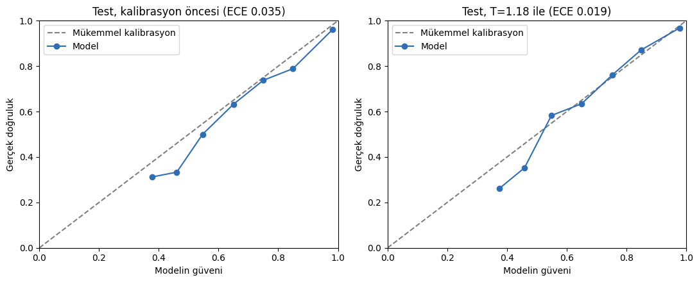
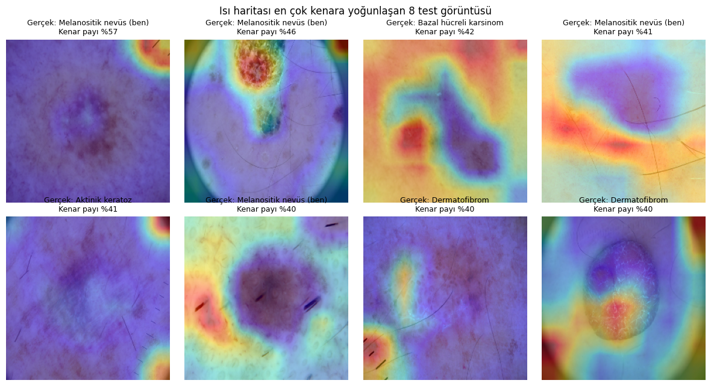

# Dermatoloji Konseyi: Çok Ajanlı Medikal Konsültasyon Sistemi

Cilt lezyonu görüntülerini sınıflandıran bir derin öğrenme modelinin kararını, birbirini denetleyen yapay zekâ ajanlarıyla sorgulayan bir **karar destek sistemi**.

> ⚠️ **Uyarı:** Bu proje eğitim ve araştırma amaçlıdır. Tıbbi teşhis aracı değildir ve klinik kararların yerine geçmez.

**Bitirme Projesi** · Fırat Üniversitesi, Yazılım Mühendisliği

**Hazırlayan:** Sabri Baz 

---

## Proje Özeti

Tıbbi görüntü sınıflandırıcıları yanlış olduklarında da yüksek güvenle karar verebilir ve kararlarının gerekçesini açıklamaz. Bu proje, bir hastanedeki doktor konseyini taklit eder:

1. **CNN** dermatoskopik görüntüyü sınıflandırır.
2. **Bulanık mantık kapısı**, modelin güvenine ve hasta riskine bakarak vakanın konseye gidip gitmeyeceğine karar verir.
3. **Literatür ajanı (RAG)** benzer vakaları ve PubMed literatürünü getirir.
4. **Çürütücü ajan** bu kanıtla CNN'in teşhisini çürütmeye çalışır ve itirazını puanlar.
5. **Bulanık mantık karar modülü** tüm sonuçları tartarak "tanı önerisi" ya da "uzmana yönlendir" kararı verir.
6. **Hakem ajan** kararı kaynaklı bir rapora döker.

Projenin katkısı, bu denetimin **kaç yanlış teşhisi düzelttiğini ve kaç doğru teşhisi bozduğunu** sayısal olarak ölçmektir.

## Sistem Mimarisi



## Veri Seti

| Veri | İçerik | Kullanım |
|---|---|---|
| [HAM10000](https://doi.org/10.7910/DVN/DBW86T) | 10.015 dermatoskopik görüntü, 7 sınıf, 7.470 lezyon | CNN eğitimi/testi, benzer vaka arşivi |
| PubMed özetleri | 7 sınıfla ilgili makale özetleri | Literatür ajanının bilgi tabanı |

Veri seti lisansı (ticari olmayan kullanım) ve boyutu nedeniyle **bu repoda yer almaz**. İndirmek için `notebooks/01_veri_hazirligi.ipynb` defterini çalıştırın (Kaggle hesabı gerekir).

**Ayrım:** Eğitim / doğrulama / test ayrımı **lezyon bazlı** ve tabakalıdır (%70 / %15 / %15). Aynı lezyonun görüntüleri hiçbir zaman iki kümeye birden düşmez.

| Sınıf | Eğitim | Doğrulama | Test |
|---|---|---|---|
| Melanositik nevüs (ben) | 4730 | 975 | 1000 |
| Melanom | 777 | 168 | 168 |
| Benign keratoz | 775 | 167 | 157 |
| Bazal hücreli karsinom | 365 | 72 | 77 |
| Aktinik keratoz | 233 | 43 | 51 |
| Vasküler lezyon | 98 | 22 | 22 |
| Dermatofibrom | 76 | 17 | 22 |
| **Toplam** | **7054** | **1464** | **1497** |

### Veri Kalite Kontrolleri

| Kontrol | Sonuç |
|---|---|
| Görüntü çözünürlüğü | 10.015 görüntünün tamamı 600×450 |
| Birebir aynı dosya (MD5) | 2 çift; her çift aynı lezyon ve tanıya ait, aynı kümede. Kümeler arası sızıntı yok |
| Bilinmeyen yaş | 57 görüntü |
| Bilinmeyen cinsiyet | 57 görüntü (47'sinde yaş da bilinmiyor) |
| Bilinmeyen lezyon bölgesi | 234 görüntü |


Ayrım dosyası: [`results/ham10000_split_ids.csv`](results/ham10000_split_ids.csv) · Ayrım tablosu: [`results/01_ayrim_tablosu.csv`](results/01_ayrim_tablosu.csv)

## Sonuçlar: Adım 2-3 (CNN)

Seçim yalnızca doğrulama kümesinde yapıldı; son CNN'in ayarları dondurulduktan sonra test kümesi açıldı. *Şeffaflık notu:* önceki sürümde (`03_..._v1`) B0 v3'ün test sonucu görülmüştü; seçim ve ayarlar yine yalnızca doğrulamaya dayanır. Son CNN: **Topluluk + TTA** (EfficientNet-B0 v3 ve B3 v3 ortalaması, test zamanı artırma ile; sıcaklık T = 1,178).

| Test kümesi (1.497 görüntü) | Ayarsız karar | Klinik eşikli karar (τ = 0,8) |
|---|---|---|
| Doğruluk | 0,821 | 0,741 |
| Dengeli doğruluk | 0,653 | 0,705 |
| Melanom duyarlılığı | 0,756 | 0,869 |
| Nevüs duyarlılığı | 0,887 | 0,734 |

Güven kalibrasyonu iyidir (ECE ≈ 0,02). Güven düşük vakaların %20'si uzmana yönlendirildiğinde doğruluk 0,903'e, kaçırılan melanom sayısı 41'den 16'ya iner.

| | |
|---|---|
|  |  |
|  |  |

Ayrıntılar ve sınırlılıklar: [`docs/tez_notlari.md`](docs/tez_notlari.md)

**Dondurulmuş son CNN ayarları:** [`results/03v2_son_cnn.json`](results/03v2_son_cnn.json) (üyeler, sıcaklık, eşikler, sınıf öncülleri). Adım 2'nin tek model seçimi: [`results/02_secilen_model.json`](results/02_secilen_model.json). Sürüm karşılaştırmaları için `results/02_cnn_b0_v{2,3,4}_*.png` (eğitim eğrileri ve karışıklık matrisleri).

**Tezde kanıt olarak kullanılacak sonuç dosyaları:**
- [`results/03v2_secim_ve_donmus_ayarlar.json`](results/03v2_secim_ve_donmus_ayarlar.json): bütün adayların doğrulama tablosu ve dondurulmuş ayarları
- [`results/03v2_test_sonuclari.json`](results/03v2_test_sonuclari.json): bütün adayların test sonuçları
- `results/02_*_dogrulama_metrikleri.json`: v1-v4 ve B3 v3 doğrulama metrikleri
- `results/02_cnn_b3_v3_egitim_egrisi.png`, `results/02_cnn_b3_v3_karisiklik_matrisi.png`: B3 v3 grafikleri

### Modeller ve büyük dosyalar

Eğitilmiş modeller (`.keras`, 80-215 MB) ve logit dosyaları (`.npy`) boyut nedeniyle repoda yoktur; Google Drive'daki `models/` klasöründe tutulur:

| Dosya | Açıklama |
|---|---|
| `cnn_b0_v3.keras`, `cnn_b3_v3.keras` | Son topluluğun üyeleri |
| `cnn_b0_v2.keras`, `cnn_b0_v4.keras` | Karşılaştırma modelleri |
| `son_cnn_dogrulama_logit.npy`, `son_cnn_test_logit.npy` | Son CNN'in ham çıktıları (Adım 8'de bulanık mantık için kullanılacak) |

## Kullanılan Teknolojiler

| Katman | Teknoloji |
|---|---|
| Geliştirme ortamı | Google Colab Pro, Google Drive |
| Görüntü sınıflandırma | TensorFlow / Keras, EfficientNet, sıcaklık ölçekleme, Grad-CAM |
| RAG | MedCPT, FAISS, Biopython (PubMed) |
| Ajanlar | Dil modeli API'si |
| Karar modülü | scikit-fuzzy (bulanık mantık) |
| Arayüz | Gradio, Hugging Face Spaces |

## Repo Yapısı

```
notebooks/   Colab defterleri (NN_konu_vX.ipynb; ayrıntı için notebooks/README.md)
src/         Tekrar kullanılan Python kodları
results/     Küçük sonuç tabloları, dondurulmuş ayar dosyaları (.json) ve grafikler
docs/        Proje önerisi, tez notları (tez_notlari.md), taslaklar
```

## İlerleme

- [x] **Adım 1:** Veri indirme, inceleme ve lezyon bazlı ayrım
- [x] **Adım 2:** CNN eğitimi (EfficientNet B0/B3, 4 sürüm)
- [x] **Adım 3:** Kalibrasyon, Grad-CAM, değerlendirme (Deney 1); son CNN: Topluluk + TTA, donduruldu
- [ ] **Adım 4:** Benzer vaka arşivi (CNN gömmeleri + FAISS)
- [ ] **Adım 5:** PubMed literatür kütüphanesi (MedCPT + FAISS)
- [ ] **Adım 6:** Literatür ajanı (Deney 2)
- [ ] **Adım 7:** Çürütücü ajan
- [ ] **Adım 8:** Bulanık mantık kapısı ve karar modülü (Deney 3-4)
- [ ] **Adım 9:** Hakem ajan ve rapor
- [ ] **Adım 10:** Toplu değerlendirme ve hata analizi
- [ ] **Adım 11:** Web arayüzü
- [ ] **Adım 12:** Tez yazımı

## Haftalık Günlük

| Hafta | Yapılanlar | Sonuç / Not |
|---|---|---|
| 1 | Veri indirildi, incelendi, lezyon bazlı ayrım yapıldı; ek kalite kontrolleri (çözünürlük, MD5 kopya, bilinmeyen meta veri) | 10.015 görüntü, 7.470 lezyon; görüntülerin ~%45'i birden fazla fotoğrafı olan lezyonlara ait, bu yüzden lezyon bazlı ayrım zorunlu. Kümeler arası sızıntı yok |
| 2-3 | CNN eğitimi (4 sürüm, B0 ve B3), aday ve topluluk karşılaştırması, sıcaklık ölçekleme, test değerlendirmesi, uzmana yönlendirme analizi, Grad-CAM | Son CNN: Topluluk (B0 v3 + B3 v3) + TTA. Test: doğruluk 0,821, dengeli doğruluk 0,653, melanom duyarlılığı 0,756; klinik eşikle melanom duyarlılığı 0,869. Isı haritalarının kenar payı ortanca %14 |

## Kaynaklar

- Tschandl, P., Rosendahl, C., Kittler, H. (2018). *The HAM10000 dataset, a large collection of multi-source dermatoscopic images of common pigmented skin lesions.* Scientific Data, 5, 180161.
- Jin, Q. ve diğ. (2023). *MedCPT: Contrastive Pre-trained Transformers with large-scale PubMed search logs for zero-shot biomedical information retrieval.* Bioinformatics.
